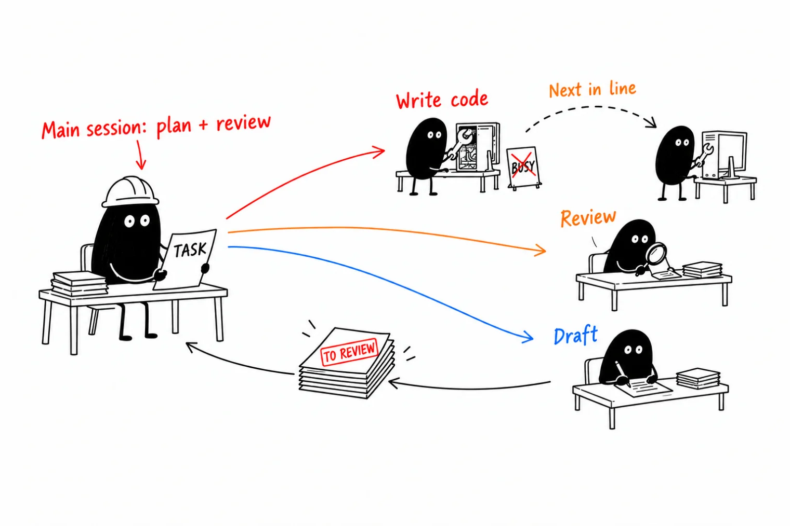
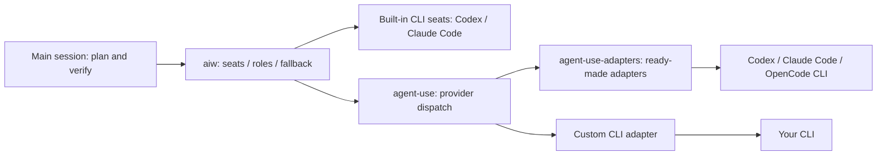

# aiw

[中文](README.md) | [English](README.en.md)

For people who use Claude Code or Codex as their main tool and often hit usage limits or fill their context. Keep the main model focused on planning and checking results; hand off reading code, running commands and drafting summaries. You configure who gets the work: a cheaper model in the same family, other subscriptions you already have, or free models. Defaults are included, and one installed CLI is enough. No service to run and no dependencies beyond Python 3.11+.

<p align="center"></p>
<p align="center"><br><sub>A real run (terminal output is in Chinese); about one minute of waiting was cut. Regenerate with <code>vhs assets/demo.tape</code>.</sub></p>

A **seat** is a model or CLI that can take an assignment. A **role** is write (edits), review (read-only review), or draft (drafts and summaries); it resolves to the first available seat in its configured order. The Codex main session has no write candidates and edits files itself.

## What problems does it solve?

- Your main model's allowance runs out: subscriptions have usage windows and weekly limits, so work can stop halfway through. Reading large files, digging through logs and running tests use up that allowance.
- Your context fills up: when the main conversation fills with file contents and command output, it gets compacted, loses details and makes mistakes.
- Your other subscriptions and free models sit idle: you have a Codex/ChatGPT subscription or free models available, but only one main conversation is doing the work.

## What changes after installation?

- **Configure it around what you have.** Use any CLI for the main session. In one local file, order candidates for edits, reviews and drafts; if the first is unavailable, use the next. Any model or CLI that runs in a terminal can connect through agent-use without code changes. See [customization](docs/guide.md#customize) and [roles](docs/guide.md#roles-and-single-cli-installations).
- Use a strong model in the main session and a cheaper one for routine work: for example, GPT-6 Astra with GPT-6.1 Sol in Codex, or Fable with Opus 5.5 in Claude ([Codex pricing](https://developers.openai.com/codex/pricing): credits per million tokens, GPT-6 Astra input 250 / output 1,250; GPT-6.1 Sol input 50 / output 250). These are examples; you can change the defaults. All models on the same account share the allowance; assignments do not create extra allowance. Claude Pro/Max also have five-hour and weekly limits shared by claude.ai and Claude Code.
- Less clutter in the main conversation: assigned work reads files and runs commands elsewhere. Those file contents and command output stay out of the main conversation; it receives only the results.
- You get another review: different models can write and review code; `aiw panel` collects independent opinions from several models.
- Keep your usual workflow: use Claude Code or Codex as usual. When work is suitable to hand off, it suggests who should take it; the main conversation decides whether to assign it.
- If a model is unavailable, it can automatically try the next one so work can continue. Roles first select an available seat; execution fallback chains are empty by default. Set alternatives and their order in [local configuration](docs/guide.md#customize).

## Want to connect more models? Use agent-use

If you have other subscriptions, local models or free models and want them to share the work, common problems are:

- **Each one works differently**, so every new connection takes its own setup. With [agent-use](https://github.com/Jerryx333/agent-use), any model you can use in a terminal connects in the same way. Add a few configuration lines; no code needed.
- **An outage or rate limit stops the work.** agent-use automatically tries the next model in your chosen order so work can continue.
- **Can you trust what another model returns?** Original responses and execution records are saved every time. All results are drafts for the main conversation to check before accepting them.

Just want common CLIs such as Codex, Claude Code and OpenCode? [agent-use-adapters](https://github.com/Jerryx333/agent-use-adapters) has ready-made adapters. Add one flag when installing aiw to set them up too, including a seat for OpenCode's free models: `~/.claude/aiw/install.sh --with-agent-use`. Manual steps are in the [guide](docs/guide.md#add-more-models-optional). The core defaults to `~/.local/share/agent-use`; when that path is absent, an existing `~/code/ai/agent-use` is retained. Adapters default to `agent-use-adapters` beside the resolved core directory. Override these with `AGENT_USE_HOME` / `AIW_ADAPTERS_HOME`.



aiw assigns work to seats; agent-use calls registered providers; agent-use-adapters supplies ready-made provider adapters. Built-in CLI seats work without the other two repositories.

`kind=agent_use` seats accept the boolean `workspace`, default false (text assignments without `--workdir/--access`; this does not hard-disable provider tools, and only `require_no_tools: true` adds `--require-no-tools`). With true, the provider must declare `tool_policy=workspace`; the seat can be a write candidate and cannot also set `require_no_tools: true`. Without `--text`, assignments pass `--workdir <absolute path> --access ro|rw`: `--ro`, `ro_only` and review use ro; other jobs use rw. ro allows only file reads, search and directory listing, with no edits or commands. rw enables all built-in tools and bypasses confirmation, without `sandbox-exec`; changes land directly in the working directory for the caller to check with diff. Neither mode loads MCP. Attachments are optional; direct workspace assignments receive a file manifest and read files themselves, while panels retain the same inline snapshot for all seats. `--net` prints a notice and has no effect; the provider decides network access. Write jobs share CLI baselines, change counts, ledger fields and reports.

`--text` implies `--ro`; workspace seats receive `--require-no-tools` without `--workdir/--access` (access=none), with attachments inline. For non-workspace agent_use and CLI seats, it only adds read-only mode. The draft role and per-file map enable it automatically; review/write and panel do not. The same rule applies to every fallback seat; combining `--text` with `--net` returns 64.

## Questions you may have

**Will quality suffer?** All assigned work is a draft for review. The main conversation checks files, evidence and test results before accepting it. The author ran a comparison: 4 real tasks (3–7 files each), each done once by the main conversation itself and once by assigning it to Codex, from the same instructions. Both versions passed the existing tests. In a blind review, GPT preferred the Codex version in 3 of 4 tasks and Claude preferred the Claude version in 3 (one tie). Each judge leaned toward its own model; neither side was clearly better.

**Does assigning work also use the main model's tokens?** Yes: writing instructions, reading results and checking them all use tokens, so it only suggests assignments; it does not make them automatically. How much it saves depends:

- On the 4 tasks above, each started from an empty session, assigning cut main-conversation usage by about a third in total, ranging from roughly even to half per task. The cost was 10–20 more minutes of waiting per task.
- In the author's daily use (about 300 tasks, not a controlled experiment), for tasks touching 3 or more files the median main-conversation cost when assigning was about a quarter of doing it directly. The gap is likely due to long sessions: everyday sessions often carry 100k–300k+ tokens of context, and every turn of editing code yourself is billed at that size.
- Small edits to 1–2 files have no comparison data; doing them yourself is usually cheaper.

To see your actual usage, use `aiw tokens` (local Claude Code main-session usage and context breakdown) and `aiw weekly` (assignment success rates, seat quality by task class, and token totals).

**How long does an assignment take?** It depends on the work. Medians from one week on the author's machine:

- Code changes: about 4 minutes. Codex reads code, edits files and runs tests; it is doing real work.
- Read-only reviews and searching a repository: about 2–3 minutes.
- Text only (drafts, summaries, second opinions): about 20 seconds with free models, about 2 minutes with Claude.

The main conversation can keep working meanwhile. For small, urgent work, doing it yourself is faster.

**Will it mess up my repository?** When write resolves to Codex, code-change work runs in the Codex sandbox: it can write only to the project directory (in a git worktree, also the Git directories `git add` needs) and has no network by default. When it finishes, it lists the changed files. Changes stay in your working tree for the main conversation to review before committing. With Claude only, claude-write uses restricted mode and a sandbox to edit workspace files, with no git add/commit. Read-only work cannot change files.

**Does it cost money?** Codex and Claude use your own accounts and their billing. Connected free models can be marked for free-tier use only and automatically disabled when charging is detected. Detection happens after a call, so this does not guarantee zero cost.

**Where does my code go?** Task instructions and attached material go to the service behind the model you assign. Models that only handle text cannot see your code by default; you must explicitly attach it. Do not send passwords, keys or private data to third-party models.

**Can I use it with just one CLI installed?** Yes. Codex only: edit code in the main session and assign reviews/drafts to another Codex session. Claude Code only: assign edits to the Opus 5.5 `claude-write` seat (requires Claude Code ≥ 2.1.259; restricted mode plus sandbox, project-directory edits only, no git add/commit), and reviews/drafts to Opus 5.5. With one family, review opens another context in that family; it is not a cross-family review. Panels require at least two seats; add an agent-use text seat if needed. Run `aiw doctor` to see role mappings.

**Can Fable cost extra?** Seats pin Opus and never automatically select Fable. On Pro, Fable is billed by usage. On Max, Fable counts toward the regular weekly limit, can use at most half of it, and consumes allowance faster than other models. See [Claude's official explanation](https://support.claude.com/en/articles/15424964-claude-fable-models-on-your-plan).

**Linux?** Untested. Only macOS has been tested.

**Are the rules too forceful?** Override them with personal rules, or remove `@~/.claude/aiw/CLAUDE.md` from `~/.claude/CLAUDE.md`. To stop assignment suggestions too, remove the aiw hooks as described in [Uninstall](docs/guide.md#uninstall).

## Five-minute start

You need macOS (the only tested OS), Python 3.11+, and logged-in Claude Code or Codex CLI (at least one). Optional: [agent-use](https://github.com/Jerryx333/agent-use) to connect more models.

1. Clone and install at this exact location:

   ```bash
   git clone https://github.com/Jerryx333/aiw.git ~/.claude/aiw
   ~/.claude/aiw/install.sh
   ```

   See the [guide](docs/guide.md#what-the-installer-changes) for changed files and backups.

2. Use each CLI's official login: `codex login`, or run `claude` and enter `/login`. Open a new terminal if PATH changed, then run:

   ```bash
   aiw doctor
   ```

   Configuration warnings do not change doctor's exit code. Codex may ask you to trust the new hook when it next starts.

3. Try a read-only review of this checkout (either installed CLI works):

   ```bash
   printf '%s\n' 'Read this repository. Explain its entry points with file references. Do not edit files.' > /tmp/aiw-review.txt
   aiw review "$HOME/.claude/aiw" 900 /tmp/aiw-review.txt --ro
   ```

   **What you will see:** The result prints straight to your terminal. Of the last two lines, `[ai-worker] 实际执行方：…` ("actual seat") names the seat that really did the work (it differs from the one you asked for when a fallback kicked in), and `[ai-worker] 全文：…` ("full text") points to the saved result. Every assignment keeps its task (`task.txt`), full result (`output.md`) and error output (`stderr.txt`) under `state/runs/<time>-<seat>-…/` in the aiw checkout. On failure the last line says 排查 ("troubleshoot") instead and points to the run directory; start with its `stderr.txt`.

4. Use Claude Code or Codex as usual. When work is suitable to hand off, it suggests who should take it; the main conversation plans and verifies.

   For example, when you type "list the edge cases" (列出边界情况) in the main session, it also receives a hint like this (actual output with the public defaults; hints are currently in Chinese):

   ```text
   [派单] 本条判定为【小段文本草稿】：只出文本草稿，交给 `aiw draft <workdir> 600 <prompt文件> --ro [--attach 文件]`，公开默认不顶替；产物待主会话核对。
   ```


## Common commands

`.` is your project; `task.txt` holds instructions; timeouts are seconds. Prepare input files first.

| Command | Purpose and example |
| --- | --- |
| `aiw <seat> <dir> <seconds> <prompt> [--ro] [--text] [--worktree] [--net]` | Assign work: `aiw review . 900 task.txt --ro`. `--ro` requests read-only; `--worktree` dispatches writes in a new branch/worktree from HEAD and reports merge/cleanup commands when retained. Unchanged worktrees are removed immediately; merged, clean ones are removed automatically; unmerged ones older than 7 days are archived as patches in `state/worktrees/archive/` before cleanup (ignored files are not archived and are deleted during cleanup); `--net` opens the network for Codex code-change work (off by default). |
| `aiw panel` | Ask several models the same question for independent opinions: `aiw panel . 600 task.txt --prior prior.md`. Pass your own judgment with `--prior`; then accept, reject or defer each opinion, without majority voting. A panel succeeds only when at least two models answer; default lists with fewer than two seats do not dispatch and return 1; an explicitly named single seat still shows its result and returns 1. Output format and options: [reference manual](docs/reference.zh-CN.md#命令) (Chinese). |
| `aiw map` | Apply one instruction per file: `aiw map . 600 task.txt src/a.py src/b.py`; defaults to the `draft` role, up to 3 jobs. |
| `aiw goal init / verify` | Create a checklist with `aiw goal init docs/goals/demo.json`; edit its example tasks, `verify` commands and `paths`, then run `aiw goal verify docs/goals/demo.json --full`. |
| `aiw doctor` | Check seats and setup: `aiw doctor`; `aiw doctor --fingerprint` prints a fingerprint (version/hash summary). |
| `aiw rate` | Rate an assignment: `aiw rate <run> ok\|fixed\|rework\|discard [--note text]`; find unrated runs with `aiw rate --pending`. |
| `aiw note` | Save an observation: `aiw note . "Check failed" --expected "Check passes" --evidence "test output"`. |
| `aiw sync` | Update this aiw checkout using `git pull --ff-only`: `aiw sync`; cannot merge divergent history. Installed agent-use and agent-use-adapters checkouts are updated too. Rerun the installer to refresh installed rules/hooks. |
| `aiw gc` | Delete old run/panel/map archives (30 days by default); preview first: `aiw gc 30 --dry-run`. |

## Getting the most out of it

- Plan first, then assign small pieces with clear checks. Do tiny, urgent tasks yourself.
- Include the goal, context, scope, constraints and verification commands; supply text seats with material via `--attach`.
- Treat results as drafts: inspect changes, check sources, run tests and read the actual-seat line.
- Before a panel, write your judgment and archive it with `--prior`; accept, reject or defer each opinion. Use `aiw goal` for large task lists.
- Use `aiw tokens` for local Claude Code usage and `aiw weekly` for assignment success rates, seat quality by task class, and token totals.

See [best practices](docs/best-practices.md) for task templates, a recommended configuration and a daily workflow.

## Optional: status line and dashboard

aiw-board is aiw's independent, read-only status line and dashboard; it does not assign tasks or write aiw state. It shows in-flight assignments, seats → actual executors, panel groups, successes and failures completed within the last 10 minutes, and today's assignment count, with status line text such as `● 派单中 N 单`, `○ 派单空闲`, `刚完成 … ✓/✗`, and `今日 N 单 ✗N`.

```bash
git clone https://github.com/Jerryx333/aiw-board.git
cd aiw-board
./install.sh --apply-settings
```

Installation backs up and replaces any existing ccstatusline configuration; `--apply-settings` modifies Claude Code settings after backing them up. Omit that flag if you prefer not to change settings automatically.
After installation, use `aiw board` to open the full dashboard; `aiw statusline` forwards to the status line. See the [aiw-board repository](https://github.com/Jerryx333/aiw-board) for details.

## More documentation

- [Usage guide](docs/guide.md): installation details, how it works and customization.
- [Best practices](docs/best-practices.md): task templates, recommended configuration and verification.
- [Reference manual](docs/reference.zh-CN.md) (Chinese): all commands and rules.

## Contributing

Documentation, reproductions and offline tests are welcome; see the [contribution guide](CONTRIBUTING.en.md) for development setup and starting points. Run `python3 tests/test_harness.py` and `python3 tests/mutation_check.py` ([test options](docs/reference.zh-CN.md#自测), Chinese), and submit changes through a PR. License: [Apache-2.0](LICENSE).
