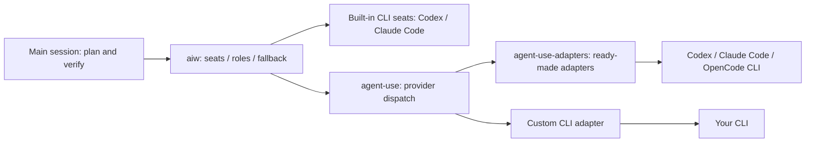

# aiw

[中文](README.md) | [English](README.en.md)

**Your main model plans and verifies; reading code, running commands and drafting go to other models.**
For people who use Claude Code, Codex, pi or omp as their main tool and keep hitting usage limits or filling their context.

<p align="center"></p>

## How light is it?

| | |
| --- | --- |
| Dependencies | Python 3.11+ only; no packages to install |
| Processes | No service, nothing resident; runs only when you assign work |
| Configuration | Works with just Claude Code or Codex installed, no configuration needed |
| Changes to your setup | One import line in `~/.claude/CLAUDE.md` and one hint hook in `settings.json` (one more of each for Codex if installed), backed up first |
| Everyday commands | 4: `aiw doctor`, `aiw review`, `aiw write`, `aiw draft` |
| Stop using it | Remove the import line, the hooks and the command symlink by hand; see [Uninstall](docs/guide.md#uninstall) |

Keep your workflow: use Claude Code or Codex as usual. When work is suitable to hand off, it suggests who should take it; you decide.

## Three steps

You need macOS (the only tested OS) and logged-in Claude Code or Codex CLI (at least one).

```bash
# 1. Install (clone to this exact location)
git clone https://github.com/Jerryx333/aiw.git ~/.claude/aiw && ~/.claude/aiw/install.sh

# 2. Check (open a new terminal first if PATH changed)
aiw doctor

# 3. First assignment: a read-only look at this repository
printf '%s\n' 'Read this repository. Explain its entry points with file references. Do not edit files.' > /tmp/aiw-review.txt
aiw review "$HOME/.claude/aiw" 900 /tmp/aiw-review.txt --ro
```

The result prints to your terminal. `[ai-worker] 实际执行方：…` ("actual seat") names the seat that did the work; `[ai-worker] 全文：…` ("full text") points to the saved result.

<p align="center"><br><sub>A real run (terminal output is in Chinese); about one minute of waiting was cut.</sub></p>

<details>
<summary>What install changes, what to look at, what to do on failure</summary>

- See the [guide](docs/guide.md#what-the-installer-changes) for changed files and backups. Log in with each CLI's official method: `codex login`, or run `claude` and enter `/login`. Codex may ask you to trust the new hook when it next starts; doctor's configuration warnings do not change its exit code.
- Every assignment keeps its task (`task.txt`), full result (`output.md`) and error output (`stderr.txt`) under `state/runs/<time>-<seat>-…/` in the aiw checkout. When a fallback kicks in, the actual seat differs from the one you asked for.
- On failure the last line says 排查 ("troubleshoot") and points to the run directory; start with its `stderr.txt`.
- Afterwards, when you type a request like "list the edge cases" in the main session, it also receives a hint (actual output with the public defaults; hints are currently in Chinese):

  ```text
  [派单] 本条判定为【小段文本草稿】：只出文本草稿，交给 `aiw draft <workdir> 600 <prompt文件> --ro [--attach 文件]`，公开默认不顶替；产物待主会话核对。
  ```

</details>

## Everyday commands

`.` is your project, `task.txt` holds instructions, timeouts are seconds.

| Command | What it does |
| --- | --- |
| `aiw write . 1200 task.txt` | Edit code (a Codex main session edits files itself and skips this) |
| `aiw review . 900 task.txt` | Read-only review, finding code in a repository |
| `aiw draft . 600 task.txt` | Drafts, rewrites, summaries |
| `aiw doctor` | Shows which model each role resolves to and checks the install |

A **role** (write / review / draft) resolves to the first available **seat** (a model or CLI that can take an assignment). Defaults are in [roles and single CLI installations](docs/guide.md#roles-and-single-cli-installations), along with notes on pi / omp main sessions.

## Why use it

- **Your main model's allowance runs out**: reading large files, digging through logs and running tests are expensive; hand them to a cheaper model in the same family, another subscription or a free model.
- **Your context fills up**: file contents and command output stay elsewhere; the main conversation receives only results.
- **Another review**: different models can write and review code.

<details>
<summary>What changes after installation, in detail</summary>

- **Configure it around what you have.** Use any CLI for the main session. In one local file, order candidates for edits, reviews and drafts; if the first is unavailable, use the next. Any model or CLI that runs in a terminal can connect through agent-use without code changes. See [customization](docs/guide.md#customize).
- Use a strong model in the main session and a cheaper one for routine work: for example, GPT-6 Astra with GPT-6.1 Sol in Codex, or Fable with Opus 5.5 in Claude ([Codex pricing](https://developers.openai.com/codex/pricing): credits per million tokens, GPT-6 Astra input 250 / output 1,250; GPT-6.1 Sol input 50 / output 250). These are examples; you can change the defaults. All models on the same account share the allowance; assignments do not create extra allowance. Claude Pro/Max also have five-hour and weekly limits shared by claude.ai and Claude Code.
- `aiw panel` collects independent opinions from several models.
- If a model is unavailable, it can try the next one; execution fallback chains are empty by default. Set alternatives and their order in [local configuration](docs/guide.md#customize).

</details>

## Questions you may have

<details>
<summary>Will quality suffer?</summary>

All assigned work is a draft for review. The main conversation checks files, evidence and test results before accepting it. The author ran a comparison: 4 real tasks (3–7 files each), each done once by the main conversation itself and once by assigning it to Codex, from the same instructions. Both versions passed the existing tests. In a blind review, GPT preferred the Codex version in 3 of 4 tasks and Claude preferred the Claude version in 3 (one tie). Each judge leaned toward its own model; neither side was clearly better.

</details>

<details>
<summary>Does assigning work also use the main model's tokens?</summary>

Yes: writing instructions, reading results and checking them all use tokens, so it only suggests assignments; it does not make them automatically. How much it saves depends:

- On the 4 tasks above, each started from an empty session, assigning cut main-conversation usage by about a third in total, ranging from roughly even to half per task. The cost was 10–20 more minutes of waiting per task.
- In the author's daily use (about 300 tasks, not a controlled experiment), for tasks touching 3 or more files the median main-conversation cost when assigning was about a quarter of doing it directly. The gap is likely due to long sessions: everyday sessions often carry 100k–300k+ tokens of context, and every turn of editing code yourself is billed at that size.
- Small edits to 1–2 files have no comparison data; doing them yourself is usually cheaper.

To see your actual usage, use `aiw tokens` (local Claude Code main-session usage and context breakdown) and `aiw weekly` (assignment success rates, seat quality by task class, and token totals).

</details>

<details>
<summary>How long does an assignment take?</summary>

Medians from one week on the author's machine: code changes about 4 minutes (Codex reads code, edits files and runs tests); read-only reviews and code search about 2–3 minutes; text only about 20 seconds with free models, about 2 minutes with Claude. The main conversation can keep working meanwhile. For small, urgent work, doing it yourself is faster.

</details>

<details>
<summary>Will it mess up my repository?</summary>

When write resolves to Codex, code-change work runs in the Codex sandbox: it can write only to the project directory (in a git worktree, also the Git directories `git add` needs) and has no network by default. When it finishes, it lists the changed files. Changes stay in your working tree for the main conversation to review before committing. With Claude only, claude-write uses restricted mode and a sandbox to edit workspace files, with no git add/commit. Read-only work cannot change files.

</details>

<details>
<summary>Does it cost money? Where does my code go?</summary>

Codex and Claude use your own accounts and their billing. Connected free models can be marked for free-tier use only and automatically disabled when charging is detected. Detection happens after a call, so this does not guarantee zero cost.

Task instructions and attached material go to the service behind the model you assign. Models that only handle text cannot see your code by default; you must explicitly attach it. Do not send passwords, keys or private data to third-party models.

</details>

<details>
<summary>Can I use it with just one CLI installed?</summary>

Yes. Codex only: edit code in the main session and assign reviews/drafts to another Codex session. Claude Code only: assign edits to the Opus 5.5 `claude-write` seat (requires Claude Code ≥ 2.1.259; restricted mode plus sandbox, project-directory edits only, no git add/commit), and reviews/drafts to Opus 5.5. With one family, review opens another context in that family; it is not a cross-family review. Panels require at least two seats; add an agent-use text seat if needed.

</details>

<details>
<summary>Can Fable cost extra?</summary>

Seats pin Opus and never automatically select Fable. On Pro, Fable is billed by usage. On Max, Fable counts toward the regular weekly limit, can use at most half of it, and consumes allowance faster than other models. See [Claude's official explanation](https://support.claude.com/en/articles/15424964-claude-fable-models-on-your-plan).

</details>

<details>
<summary>Linux? Are the rules too forceful?</summary>

Linux is untested; only macOS has been tested.

If the rules feel too forceful, override them with personal rules, or remove `@~/.claude/aiw/CLAUDE.md` from `~/.claude/CLAUDE.md`. To stop assignment suggestions too, remove the aiw hooks as described in [Uninstall](docs/guide.md#uninstall).

</details>

## Advanced (optional)

<details>
<summary>More commands: panels, batches, checklists, ratings, updates, cleanup</summary>

| Command | Purpose and example |
| --- | --- |
| `aiw <seat> . 900 task.txt` | Assign to a named seat; common flags: `--ro` read-only, `--worktree` writes in an independent worktree, `--net` opens the network for Codex writes; details in the [reference manual](docs/reference.zh-CN.md#命令) (Chinese) |
| `aiw panel` | Collect independent opinions: `aiw panel . 600 task.txt --prior prior.md`; pass your own judgment with `--prior`, then accept, reject or defer each opinion, without majority voting |
| `aiw map` | Apply one instruction per file: `aiw map . 600 task.txt src/a.py src/b.py` |
| `aiw goal init / verify` | Create a checklist with `aiw goal init docs/goals/demo.json`; edit tasks, verification commands and paths, then run `aiw goal verify docs/goals/demo.json --full` |
| `aiw rate` | Rate an assignment: `aiw rate <run> ok\|fixed\|rework\|discard [--note text]`; find unrated runs with `aiw rate --pending` |
| `aiw note` | Save an observation: `aiw note . "Check failed" --expected "Check passes" --evidence "test output"` |
| `aiw sync` | Fast-forward aiw and installed agent-use/agent-use-adapters; rerun the installer to refresh rules/hooks |
| `aiw gc` | Clean old archives (30 days by default); preview: `aiw gc 30 --dry-run` |

</details>

<details>
<summary>Connect more models: agent-use</summary>

Want other subscriptions, local models or free models to share the work? [agent-use](https://github.com/Jerryx333/agent-use) connects any model you can use in a terminal in the same way with a few configuration lines, no code; when one is unavailable it tries the next in your order; original responses and execution records are saved for the main conversation to check.

[agent-use-adapters](https://github.com/Jerryx333/agent-use-adapters) has ready-made Codex, Claude Code and OpenCode adapters. Install them with `~/.claude/aiw/install.sh --with-agent-use`, which also registers providers such as `opencode` in agent-use; add seats yourself in your local configuration. Built-in Codex / Claude Code seats work without these two repositories.



For setup steps, workspace seats, `--text` and other details, see the [usage guide](docs/guide.md#add-more-models-optional).

</details>

<details>
<summary>Getting the most out of it</summary>

- Plan first, then assign small pieces with clear checks. Do tiny, urgent tasks yourself.
- Include the goal, context, scope, constraints and verification commands; supply text seats with material via `--attach`.
- Treat results as drafts: inspect changes, check sources, run tests and read the actual-seat line.
- Before a panel, write your judgment and archive it with `--prior`. Use `aiw goal` for large task lists.

See [best practices](docs/best-practices.md) for task templates, a recommended configuration and a daily workflow.

</details>

<details>
<summary>Status line and dashboard: aiw-board</summary>

[aiw-board](https://github.com/Jerryx333/aiw-board) is an independent, read-only status line and dashboard; it does not assign tasks or write aiw state. It shows in-flight assignments, actual seats, panel groups, recent successes and failures, and today's count.

```bash
git clone https://github.com/Jerryx333/aiw-board.git
cd aiw-board
./install.sh --apply-settings
```

Installation backs up and replaces any existing ccstatusline configuration; `--apply-settings` modifies Claude Code settings after backing them up. Omit that flag to leave settings unchanged. After installation, open the full dashboard with `aiw board`.

</details>

## Docs and contributing

[Usage guide](docs/guide.md) (installation, how it works, customization) · [Best practices](docs/best-practices.md) · [Reference manual](docs/reference.zh-CN.md) (Chinese; all commands and rules) · [Contribution guide](CONTRIBUTING.en.md)

Submit changes through a PR; run `python3 tests/test_harness.py` and `python3 tests/mutation_check.py` first. License: [Apache-2.0](LICENSE).
