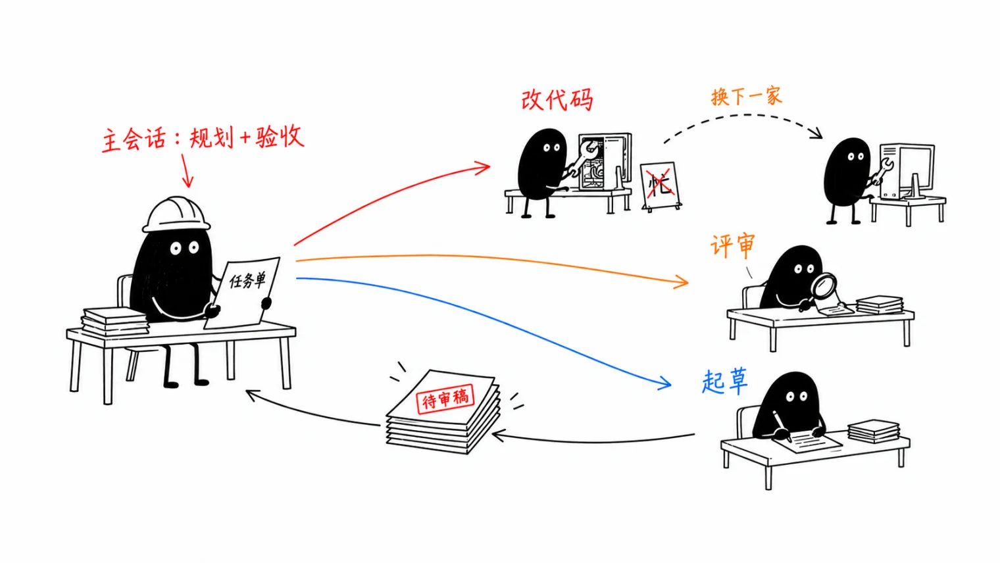
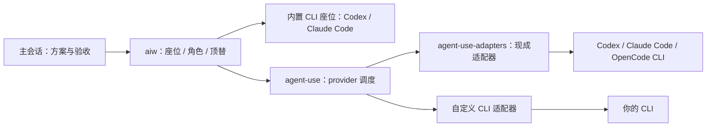

# aiw

[中文](README.md) | [English](README.en.md)

给用 Claude Code 或 Codex 当主力、常被额度卡住或上下文撑爆的人。主模型专心规划和把关，读代码、跑命令、起草摘要这类体力活派出去。派给谁由你配：同一家更省的模型、你已有的其他订阅、免费模型都行。装好有默认配置，只装一家也能用。不用起服务，除 Python 3.11+ 外不装依赖。

<p align="center"></p>
<p align="center"><br><sub>真实运行录屏，等待执行方的约 1 分钟已剪掉；用 <code>vhs assets/demo.tape</code> 可重新生成。</sub></p>

**座位**是一个可派单的模型或 CLI；**角色**是 write（改文件）、review（只读评审）、draft（起草和摘要），按配置顺序解析到第一个可用座位。Codex 主会话的 write 候选为空，改文件自己做。

## 解决什么问题

- 主模型额度不够用：订阅有时间窗口和周限额，活干到一半就停；读大文件、翻日志、跑测试这类活很耗额度。
- 上下文被撑爆：主会话塞满文件内容和命令输出后会被压缩、忘细节、出错。
- 已有的订阅和免费模型闲着：手里有 Codex/ChatGPT 订阅或免费模型，却只有一个主会话在干活。

## 装上之后有什么不同

- **按你手里的东西配。** 主会话用哪个 CLI 都行；改代码、评审、起草三类活各派给谁，在一个本地配置文件里排好候选顺序，第一个不可用就用下一个；任何能在终端里跑的模型或 CLI 都能接进来（经 agent-use），不用改代码。见[自定义](docs/guide.zh-CN.md#自定义)和[角色配置](docs/guide.zh-CN.md#角色与单家安装)。
- 主会话用强模型，体力活派给同一家更省的模型：比如 Codex 主会话用 GPT-6 Astra、派单用 GPT-6.1 Sol，或 Claude 主会话用 Fable、派单用 Opus 5.5（[Codex 定价](https://developers.openai.com/codex/pricing)：每百万 token，GPT-6 Astra 输入 250 / 输出 1,250 credits，GPT-6.1 Sol 输入 50 / 输出 250 credits）。这是举例，默认配置可改。同一账号下所有模型共用额度，派单不会多出额度。Claude Pro/Max 还有 5 小时限额和周限额，claude.ai 与 Claude Code 共用。
- 主会话少装过程：派出去的活在别处读文件、跑命令，读过的文件和命令输出不进主会话，主会话只收结果。
- 多一道交叉评审：改代码和评审可以由不同模型做；`aiw panel` 收集多家独立意见。
- 不用改习惯：照常用 Claude Code 或 Codex；遇到适合派出去的活，它会提示这件事该交给谁，派不派由主会话决定。
- 某家不可用时自动换下一家，活不会卡住；角色先选首个可用座位；执行中的顶替链默认为空，换谁、按什么顺序在[本地配置](docs/guide.zh-CN.md#自定义)里定。

## 想接更多模型？用 agent-use

手里有别家的订阅、本地模型或免费模型，想让它们也分担工作，常见的麻烦是：

- **每家用法都不一样**，接一个就得单独折腾一套。用 [agent-use](https://github.com/Jerryx333/agent-use)，任何能在终端里用的模型都按同一种方式接进来，加几行配置就行，不用写代码。
- **某家一挂、一限流，活就卡住。** agent-use 会按你排好的顺序自动换下一家，活不会断。
- **别的模型交回来的东西靠不靠谱？** 每次都留存原文和过程记录，结果一律当待审稿，由主会话核对后才算数。

只想接 Codex、Claude Code、OpenCode 这几家常见 CLI？[agent-use-adapters](https://github.com/Jerryx333/agent-use-adapters) 已经写好适配器。安装 aiw 时加一个参数就能一起装好，还会补上 OpenCode 免费模型座位：`~/.claude/aiw/install.sh --with-agent-use`。手工接入步骤见[使用指南](docs/guide.zh-CN.md#接入更多模型可选)。核心默认装在 `~/.local/share/agent-use`；新路径不存在时沿用已有的 `~/code/ai/agent-use`。适配器默认在解析出的核心目录同级的 `agent-use-adapters`；可用 `AGENT_USE_HOME` / `AIW_ADAPTERS_HOME` 覆盖。



aiw 负责把任务交给座位；agent-use 负责调用注册的 provider；agent-use-adapters 提供现成的 provider 适配器。只用内置 CLI 座位不需要后两个仓库。

`kind=agent_use` 座位可选布尔字段 `workspace`，默认 false（文本派单，不传 `--workdir/--access`，但不会因此硬禁供应商工具；只有配置 `require_no_tools: true` 才传 `--require-no-tools`）。设为 true 时，provider 必须声明 `tool_policy=workspace`；可进入 write 候选，不能同时设 `require_no_tools: true`。未启用 `--text` 时，派单传 `--workdir <绝对路径> --access ro|rw`：`--ro`、`ro_only`、review 使用 ro，其余使用 rw。ro 只能读文件、搜索和列目录，不能编辑或跑命令；rw 开放全部内置工具并跳过确认，不套 `sandbox-exec`，文件直接改在工作目录，调用方用 diff 验收。两种模式均不加载 MCP。附件可选；直接派单给 workspace 座位文件清单，由它自行读取，panel 仍给各家同一份附件全文快照。`--net` 只打印说明、不生效，联网由供应商决定；写单复用 CLI 的 baseline、改动统计、账本与汇报。

`--text` 隐含 `--ro`；workspace 座位改传 `--require-no-tools`，不传 `--workdir/--access`（access=none），附件改为全文；非 workspace agent_use 和 CLI 座位仅增加只读约束。draft 角色和逐文件 map 自动启用，review/write 与 panel 不自动启用；顶替链逐座位应用同一规则，`--text` 与 `--net` 同用返回 64。

## 你可能会担心的

**质量会不会降？** 派出去的产出都是待审稿，主会话核对文件、证据和测试结果后才算数。作者做过一次对照：4 个真实需求（各改 3–7 个文件），同一份要求分别由主会话自己改、派给 Codex 改，两边都过了现有测试。请 GPT 和 Claude 盲评，GPT 在 4 题里 3 题选了 Codex 那份，Claude 3 题选了 Claude 那份、1 题打平，评委偏向自家模型，看不出哪边更好。

**派单本身也花主模型 token 吧？** 是的：写要求、读结果、核对都要花，所以只提示、不自动派。省多少看情况：

- 上面那 4 个需求，每个都从空会话开始做：派单时主会话合计少花约三分之一，单个需求从基本持平到少一半不等；代价是每个需求多等 10–20 分钟。
- 作者日常使用（约 300 个需求，不是对照实验）：改 3 个文件以上的需求，派单时主会话花费的中位数约为自己改的四分之一。差距可能来自长会话：平时会话常带着十几万到几十万的上下文，自己改代码的每一轮都按这个量计费。
- 改 1–2 个文件的小活没有对照数据，通常自己做更划算。

想看自己的实际用量：`aiw tokens`（本机 Claude Code 主会话用量和上下文构成）、`aiw weekly`（派单成功率和 token 汇总）。

**派一单要等多久？** 看活的类型。按作者本机一周的记录（中位数）：

- 改代码：约 4 分钟。Codex 要读代码、改文件、跑测试，是真在干活。
- 只读评审、在仓库里找代码：约 2–3 分钟。
- 只写文字（起草、摘要、第二意见）：免费模型约 20 秒，Claude 约 2 分钟。

派出去后主会话可以接着做别的；又小又急的活，自己做更快。

**会不会把我的仓库改乱？** write 角色解析到 Codex 时在 Codex 沙箱里跑：只能写项目目录（在 git worktree 里还包括 `git add` 需要的 Git 目录），默认不联网。结束时列出改了哪些文件，改动留在工作区，由主会话看过再提交。只有 Claude 时用 claude-write 的受限模式和沙箱，只改工作区文件，不能 git add/commit。只读单不能改文件。

**会不会花钱？** Codex、Claude 按你自己的账号计费。接入的免费模型可以标成只用免费档，一旦检测到收费会自动停用；但这是调用之后才检测，不保证零费用。

**代码会发到哪里？** 交给哪个模型，任务要求和附带材料就发给那个模型背后的服务。只负责写文字的模型默认看不到你的代码，要你明确附上才会发过去。密码、密钥和私人数据不要交给第三方模型。

**只装了一家能用吗？** 能。只有 Codex：改代码主会话自己做，评审和起草派另一个 Codex 会话。只有 Claude Code：改代码派 Opus 5.5 的 `claude-write` 座位（需要 Claude Code ≥ 2.1.259；受限模式加沙箱，只能改项目目录，不能 git add/commit），评审和起草派 Opus 5.5。单家时的评审是同一家另开上下文，不是跨家族复核；会诊需要至少两家，可接 agent-use 文本座位。角色解析到哪个座位见 `aiw doctor`。

**Fable 会不会多花钱？** 座位默认固定 Opus，不会自动用 Fable。Pro 计划上 Fable 按量付费；Max 上 Fable 计入常规周限额、最多占周限额一半，且消耗快于其他模型。见 [Claude 官方说明](https://support.claude.com/en/articles/15424964-claude-fable-models-on-your-plan)。

**支持 Linux 吗？** 尚未测试。已测试 macOS。

**规则太强势怎么办？** 用个人规则覆盖，或从 `~/.claude/CLAUDE.md` 删除 `@~/.claude/aiw/CLAUDE.md`。若也不想收到派单提示，按[卸载小节](docs/guide.zh-CN.md#卸载)移除 aiw 钩子。

## 5 分钟上手

需要 macOS（目前只在 macOS 测试过）、Python 3.11+，以及已登录的 Claude Code 或 Codex CLI（至少一个）；可选 [agent-use](https://github.com/Jerryx333/agent-use)，用于接入更多模型。

1. 克隆到此固定位置，再安装：

   ```bash
   git clone https://github.com/Jerryx333/aiw.git ~/.claude/aiw
   ~/.claude/aiw/install.sh
   ```

   安装会改哪些文件、怎么备份，见[使用指南](docs/guide.zh-CN.md#安装做了什么)。

2. 按官方方式登录各 CLI：`codex login`；或运行 `claude`，输入 `/login`。PATH 有变化时新开终端，然后运行：

   ```bash
   aiw doctor
   ```

   配置警告不改变 doctor 退出码。Codex 下次启动可能要求信任新钩子。

3. 第一单：只读查看本仓库，任一家已安装的 CLI 都能跑：

   ```bash
   printf '%s\n' '阅读本仓库，说明入口，并引用文件位置。不要修改文件。' > /tmp/aiw-review.txt
   aiw review "$HOME/.claude/aiw" 900 /tmp/aiw-review.txt --ro
   ```

   **跑完你会看到什么：** 结果直接打印在终端。最后两行里，`[ai-worker] 实际执行方：…` 是真正干活的座位（某家不可用被顶替时会和你点的不同），`[ai-worker] 全文：…` 是完整结果的存档。每单的任务原文（`task.txt`）、完整结果（`output.md`）和错误输出（`stderr.txt`）都存在 aiw 仓库的 `state/runs/<时间>-<座位>-…/` 里。失败时最后一行改为「排查」目录，先看其中的 `stderr.txt`。

4. 之后照常用 Claude Code 或 Codex。遇到适合派出去的活，它会提示该交给谁，主会话决定方案并验收。

   例如你在主会话里输入「列出边界情况」，主会话会同时收到这样一条提示（公开默认配置下的实际输出）：

   ```text
   [派单] 本条判定为【小段文本草稿】：只出文本草稿，交给 `aiw draft <workdir> 600 <prompt文件> --ro [--attach 文件]`，公开默认不顶替；产物待主会话核对。
   ```


## 常用命令

`.` 是项目目录，`task.txt` 是任务要求，超时单位为秒。先准备输入文件。

| 命令 | 用途与示例 |
| --- | --- |
| `aiw <座位> <目录> <秒数> <prompt文件> [--ro] [--text] [--worktree] [--net]` | 派一单：`aiw review . 900 task.txt --ro`。`--ro` 要求只读；`--worktree` 从当前 HEAD 创建独立分支/worktree 派写单，保留时报告合并与清理命令。无改动即时清理；已合并且干净的自动清理；超过 7 天未合并的先存档补丁到 `state/worktrees/archive/` 再清理（被忽略文件不存档，删除时一并删除）；`--net` 给 Codex 改代码的单开放网络，默认关闭。 |
| `aiw panel` | 同一个问题问几家，收集独立意见：`aiw panel . 600 task.txt --prior prior.md`。`--prior` 传入你自己的判断；看完逐条决定接受、驳回或暂缓，不按多数票。至少两家给出意见才算会诊成功，默认名单不足两家时不派单、返回 1；显式指定单家仍展示结果并返回 1。输出格式和选项见[参考手册](docs/reference.zh-CN.md#命令)。 |
| `aiw map` | 对每个文件执行同一要求：`aiw map . 600 task.txt src/a.py src/b.py`；默认用 `draft` 角色，最多并发 3 单。 |
| `aiw goal init / verify` | 用 `aiw goal init docs/goals/demo.json` 建清单；修改示例任务、`verify` 命令和 `paths`，再跑 `aiw goal verify docs/goals/demo.json --full`。 |
| `aiw doctor` | `aiw doctor` 检查座位和安装；`aiw doctor --fingerprint` 输出一行配置指纹，即版本和哈希摘要，便于比较。 |
| `aiw note` | 保存观察：`aiw note . "检查失败" --expected "检查通过" --evidence "测试输出"`。 |
| `aiw sync` | `aiw sync` 用 `git pull --ff-only` 更新 aiw 仓库，不能合并分叉历史；已安装的 agent-use 和 agent-use-adapters 也一并更新；更新已安装规则/钩子需重跑安装。 |
| `aiw gc` | 删除旧的派单、会诊、批处理归档，默认保留 30 天；先预览：`aiw gc 30 --dry-run`。 |

## 用好它

- 先定方案，再派能写清验收条件的小块；又小又急的活自己做。
- 每单写清目标、上下文、范围、约束和验收命令；文本座位需要用 `--attach` 带上材料。
- 产出当待审稿：看改动、核对出处、跑测试，并看「实际执行方」。
- 会诊先写自己的判断，用 `--prior` 归档；逐条接受、驳回或暂缓，大任务用 `aiw goal` 清单。
- 用 `aiw tokens` 看本机 Claude Code 用量，用 `aiw weekly` 看派单成功率和 token 汇总。

任务单模板、推荐配置和一天的用法见[最佳实践](docs/best-practices.zh-CN.md)。

## 可选：状态栏和看板

aiw-board 是 aiw 的独立只读状态栏和看板，不派单、不写 aiw 状态；展示在途派单、座位→实际执行方、会诊分组、10 分钟内刚完成的成败和今日单数，状态栏文字如 `● 派单中 N 单`、`○ 派单空闲`、`刚完成 … ✓/✗`、`今日 N 单 ✗N`。

```bash
git clone https://github.com/Jerryx333/aiw-board.git
cd aiw-board
./install.sh --apply-settings
```

安装会备份并替换已有 ccstatusline 配置；`--apply-settings` 会修改 Claude Code settings（先备份），不想自动修改 settings 就去掉该参数。
装好后用 `aiw board` 打开完整看板，`aiw statusline` 转发到状态栏；细节见 [aiw-board 仓库](https://github.com/Jerryx333/aiw-board)。

## 更多文档

- [使用指南](docs/guide.zh-CN.md)：安装细节、工作原理和定制。
- [最佳实践](docs/best-practices.zh-CN.md)：派单模板、推荐配置和验收方法。
- [中文参考手册](docs/reference.zh-CN.md)：全部命令与细则。

## 参与贡献

欢迎补文档、复现问题或完善离线测试，切入点和开发方式见[贡献指南](CONTRIBUTING.md)。运行 `python3 tests/test_harness.py` 和 `python3 tests/mutation_check.py`（并发等选项见[参考手册](docs/reference.zh-CN.md#自测)），改动走 PR。许可证：[Apache-2.0](LICENSE)。
